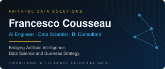

  

  <b>English</b> · <a href="README.pt-BR.md">Português (Brasil)</a>

## About

I'm an AI Engineer, Data Scientist and BI Consultant based in Santa Catarina, Brazil, and the founder of **Faithful Data Solutions**.

My background is in Business Administration (Foreign Trade) and a Logistics MBA, so I tend to start from the business decision and work back to the data, the model and the evidence. I'm now deepening my work in machine learning, data engineering and generative AI, and my public projects focus on one thing: connecting technical choices to a measurable business outcome.

- **What I do:** applied machine learning, data pipelines, business analytics and AI solutions for real business problems.
- **How I work:** leakage-aware validation, reproducible environments, documented limitations, and results expressed in business terms.
- **Open to:** consulting, remote opportunities, research and teaching collaborations.

## Selected projects

| Project | What it shows |
|---|---|
| [**Credit-risk predictive pipeline**](https://github.com/francescousseau/sctec/tree/main/projetos/02-projeto-avaliativo-risco-credito) | End-to-end binary classification (KNN vs. decision tree) on 32,581 loan records, with data-leakage prevention, overfitting diagnosis and a **cost-of-error analysis in currency**. |
| [**Casting-part image pre-processing**](https://github.com/francescousseau/preprocessamento-pecas-fundidas) | A tested OpenCV batch pipeline (grayscale, Gaussian blur, Otsu, morphology, Canny) prepared for a future quality-classification model. |
| [**E-commerce data sanitization (Olist)**](https://github.com/francescousseau/sctec/tree/main/projetos/01-mini-projeto-ml-visao-computacional) | A pure-Python ETL/cleaning pipeline (`csv`, regex, datetime) with business-rule validation and a statistics report. |

### Credit-risk pipeline in five lines

- **Problem:** decide, before granting credit, whether a customer will default, where a false negative and a false positive have opposite economic costs.
- **Approach:** KNN vs. decision tree, selected by F1 and recall on the default class, then judged by financial cost.
- **Engineering:** cleaning rules before the split, all preprocessing inside a `Pipeline`, cross-validated hyperparameters, test set opened once, threshold learned from out-of-fold probabilities.
- **Results:** the decision tree (`max_depth=7`) costs R$ 2.82 M against R$ 3.85 M for KNN on the test set, even though KNN has the better recall. Moving the threshold from 0.50 to 0.69 lowers the cost to R$ 2.73 M.
- **Business value:** the tree is auditable, so each denial can be explained. The project states its own limits: public dataset, assumed LGD, no out-of-time validation and a documented *availability-leakage* caveat on `loan_grade`.

## Technical stack

Grouped by how I can evidence it, not by how popular the tool is.

| Level | Tools |
|---|---|
| **Applied in projects** (visible in public repositories) | Python · NumPy · pandas · SciPy · scikit-learn · imbalanced-learn · Matplotlib · Seaborn · Jupyter · OpenCV · pytest · Git and GitHub |
| **Used in professional work** (client and consulting work, not published in repositories) | AWS · Apache Spark · Apache Airflow · Looker · Tableau · MongoDB · Streamlit · Dash · TensorFlow · Keras |
| **Developer tooling** | Cursor · OpenCode · Orca · Kepler |
| **Familiar with** (training and certifications) | SQL · DAX and Power BI · Azure Data Factory · prompt engineering · GitHub Copilot |
| **Currently learning** | Generative AI · LLM applications · AI agents · Retrieval-Augmented Generation · MLOps |

## Education

**Academic**
- B.A. in Business Administration, International Business / Foreign Trade, Celer Faculdades (2006–2010)
- MBA in Business Logistics, Celer Faculdades (09/2009–02/2011)

**Postgraduate (in progress)**
- Specialization (Lato Sensu) in Artificial Intelligence, Gran Faculdade (10/2026–10/2027)
- Specialization (Lato Sensu) in Higher Education Teaching, Gran Faculdade (10/2026–10/2027)

## Certificates and training

**Professional certificates**
- [Google Cybersecurity](https://www.coursera.org/account/accomplishments/specialization/77L47DMWGL3J)
- [Google AI Essentials](https://www.credly.com/badges/4a5a13a3-b41b-40f9-8b5d-5996f59fd9d4/linked_in_profile)
- [IBM AI Engineering Professional Certificate](https://www.credly.com/badges/a4a82cc0-d483-43e2-aef4-46ea8c1abc74/linked_in_profile)
- [Google Data Analytics](https://coursera.org/share/64455f2d92c4d62d6eafda03ca61dc30) (PT)
- [Google Project Management](https://coursera.org/share/54c6c1a3e46c7328d883a7d7b65f8366) (PT)
- [Cisco Data Analytics Essentials](https://www.credly.com/badges/81a6db96-ea8f-45dc-963d-90a29281b3ef/linked_in_profile)
- Applied Data Science with Python, University of Michigan (08/2026)

**Specialized training and courses**
- Prompt Engineering for Software Engineers (course), MBA USP/Esalq (03/2026)
- Data Science Programmer, Codi Academy (03/2026)
- DIO: Nexa Machine Learning and GenAI in Practice (12/2025) · Microsoft Acceleration AI and Data Architecture (12/2025) · Microsoft 50 Years: Smart Prompts and GitHub Copilot (11/2025) · Python Data Analytics (06/2024)
- XP Educação (2022–2023): Data Analyst · Python Developer · BI Manager · Data Scientist · Fixed-Income and Variable-Income Data Scientist · Agile Expert

All credentials are also listed on [LinkedIn](https://www.linkedin.com/in/francescousseau/) and [Credly](https://www.credly.com/users/francescousseau).

## Connect

If you have a data or AI problem where the business case matters as much as the model, I'd like to hear about it. The best way to reach me is LinkedIn.
